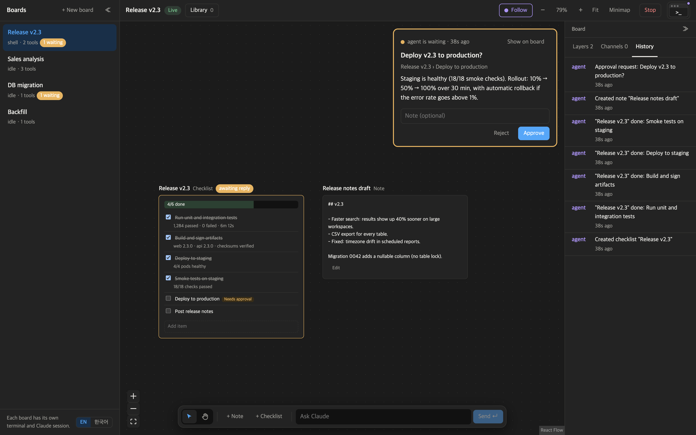
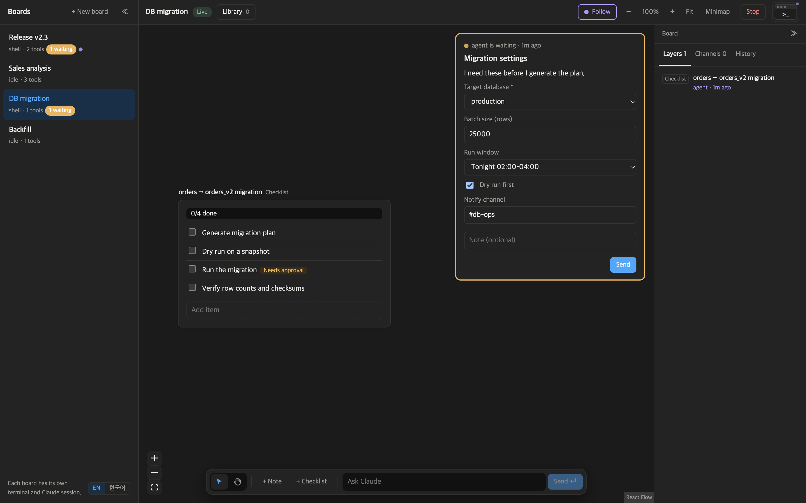
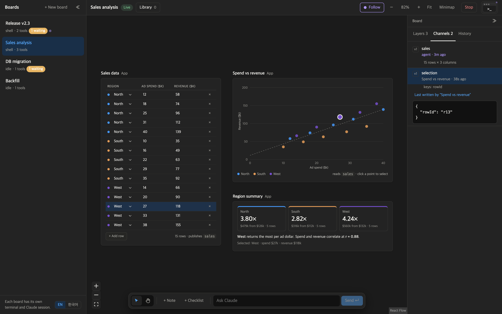
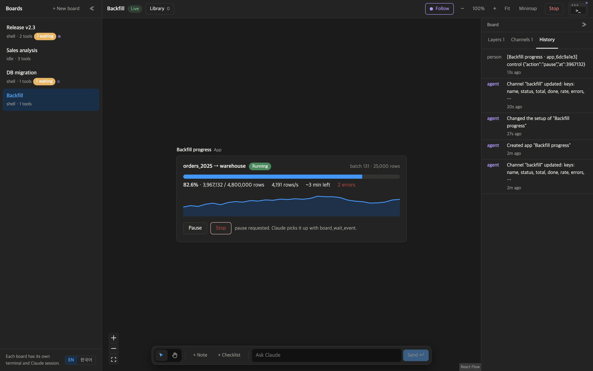
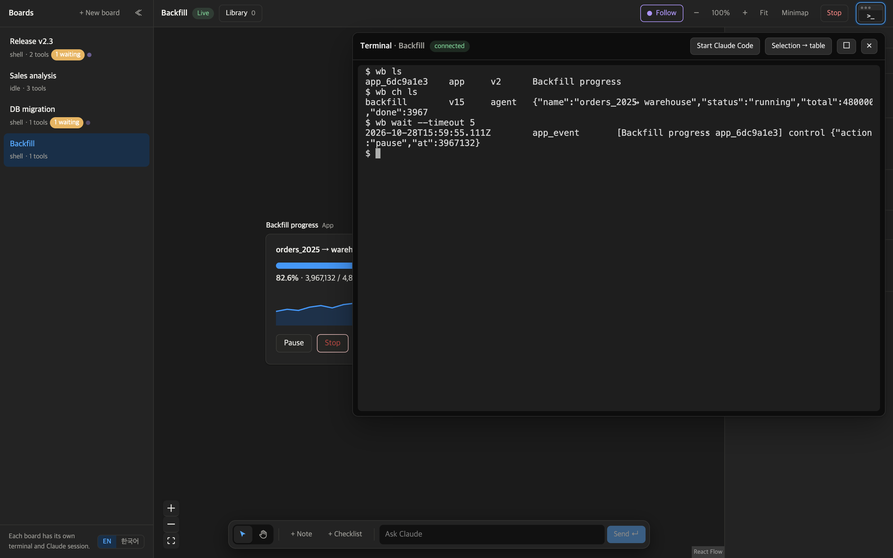

# Shellside

**A canvas board beside your terminal, where your coding agent and you share live tools and apps.**

CLI agents like Claude Code do real work, but their only window to you is terminal text. Input means long prompts and
y/n questions, progress gets buried in scrollback, and anything outside the terminal has to be copied and pasted in.

Shellside gives every terminal agent a board. The agent builds checklists, forms, tables and full React apps on it,
reads what you change, reports progress as it works, and stops to ask you before risky steps. Every tool is JSON
(spec and state), so you and the agent read and change the same thing.

> **Status: proof of concept.** It runs locally, one Claude Code session per board. See [Security](#security) before you try it.

## Demo: one request, a live browser, two linked apps

https://github.com/user-attachments/assets/2aeefd23-2b63-41ff-adac-d546228b2796

<sub>Claude Code in the board's terminal opens a page in the board browser, creates a table app and a chart app for the
request, and links them. 68 s; long waits are sped up. Also in the repo: [docs/media/shellside-demo.mp4](docs/media/shellside-demo.mp4).</sub>

1. **The board's own terminal.** Every board has a terminal, a real shell rendered with [wterm](https://github.com/vercel-labs/wterm).
   **Start Claude Code** starts Claude Code in it, already connected to this board through the board's MCP server.
2. **Ask in the terminal, as usual.** *"Open the Wikipedia list of the tallest buildings in the board browser. Put the top 8
   in an editable table app and add a bar chart app that follows the table live. Link browser -> table -> chart."*
3. **Claude works on the board while you watch.** It drives a real Chrome tab on the board, then **creates new app
   components for this request**: nothing was prebuilt. It writes the React code for an editable table and a live chart
   (the chart reads the table's data), the board compiles and runs them in sandboxed frames at once, and Claude links
   them with arrows that show the flow.
4. **You edit, the chart follows.** Change a height in the table and the chart redraws at once. You and Claude work on the
   same state.
5. **Ask from the board too.** Type `@name` in the box at the bottom to point at a tool. The request lands in the same
   Claude Code session in the terminal, and Claude changes the app it created.

## What it looks like

### Claude runs the steps, you approve the risky one



Claude has checked off each step with a one-line result. Steps marked `gate: "human"` can't be
checked by the agent: it calls
`board_ask`, an approval card appears, and the server marks the step done only after you approve. The history panel
shows who did what.

### Ask with a form, not a string of y/n prompts



When Claude needs several values, it asks once with a form (`board_ask` with `kind: "input"`) and gets the answers back
as JSON, instead of asking one question at a time in the terminal.

### Apps that share live data



When the four built-in tools aren't enough, Claude writes an **app**: a React component that runs in a sandboxed iframe
on the board. Apps exchange data through **channels**, named values every app on the board can read, write and watch.
Here, three separate apps share the `sales` and `selection` channels: edit a number in the table and the plot and the
summary update instantly; click a point and the matching row lights up. The **Channels** panel shows what is flowing.

```jsx
import { useChannel } from "board";

export default function App() {
  const [sales, setSales] = useChannel("sales", { columns: [], rows: [] }); // shared with every app on the board
  const [selection, setSelection] = useChannel("selection", null);
  // …
}
```

Apps can also read any other tool live (`useTool(id)`), list the board's tools (`useTools()`), and change another
tool with a JSON Patch (`board.writeTool`). Those writes count as the agent's, so read-only settings and approval
gates still apply.

### Long jobs you can watch and steer



Claude writes progress to a channel while the job runs (`channel_write`, or `wb ch set backfill …` from a script), and
the app redraws on each write. Pause and Stop in the app send events that reach Claude through `board_wait_event`.
Repeated writes collapse into a single history line until Claude reads them.

### A browser you both use

A **browser** frame is a real Chrome tab on the board. You browse in it with mouse and keyboard (Korean and other IME
input included); Claude reads the same page as text with refs (`[@5 textbox "Email"]`, `[@10 button "Send"]`) and drives
it with batched steps (`browser_act`: fill, click, wait…, then a fresh snapshot), like
[ego-lite](https://github.com/citrolabs/ego-lite)'s browser for agents. You see a marker on everything Claude clicks.
**Take over** whenever you want (Claude waits until you hand it back), and Claude hands the browser to you for sign-ins,
CAPTCHAs and payments (`browser_handoff`). Downloads land in the board's folder. Details: [poc/README.md](poc/README.md#board-browser).

### The agent's side: MCP and the `wb` CLI



Each board has its own terminal and its own Claude Code session, connected to that board's MCP server (`board_list`,
`tool_read`, `tool_write`, `board_ask`, `app_create`, `channel_write`, …). Agents without MCP, and plain scripts,
use the `wb` CLI for the same things.

## How it works

```
 Browser ──────────────────────────────┐        Board terminal (one per board)
 │ canvas board (React Flow)            │        ┌───────────────────────────────┐
 │ app iframes (sandboxed)  ⇄ channels  │        │ zsh/bash → claude             │
 │ terminal pane (wterm)                │        │   ├─ MCP: /mcp/<boardId>       │
 └──────────── WebSocket ───────────────┘        │   └─ wb CLI                   │
                  │                               └───────────────┬───────────────┘
                  ▼                                               │
        Shellside server (127.0.0.1:4100) ◀────── HTTP / MCP ─────┘
        boards · tools · asks · channels · history · PTY sessions
```

- **Tools are data.** A tool is `{ kind, props, state }` (checklist, form, table, note, or app). The board draws it;
  the agent reads and writes its state with JSON Patch, passing the version it read so it can't overwrite your newer edit.
- **Both directions.** The agent pulls (MCP, `wb`); you push (edits, approvals, messages, Stop), and the agent receives
  them with `board_wait_event` or as a note on its next MCP reply.
- **One board = one workspace = one Claude session.** Each board gets its own folder, `CLAUDE.md` rules, MCP config and
  status hooks, so the board knows whether Claude is idle, working or waiting for permission.

The full design is in [docs/product-plan.md](docs/product-plan.md). The PoC internals are in [poc/README.md](poc/README.md).

## Quick start

Requirements: macOS or Linux, Node.js 22+, [Claude Code](https://claude.com/claude-code) installed and signed in, and
Google Chrome (or Chromium, Edge, Brave) for the board browser.

```bash
cd poc
npm install
npm run dev
```

Open <http://127.0.0.1:5173>, open a board's terminal (top right), press **Start Claude Code**, and ask for something,
for example: *"Make a release checklist for v2.3 and run it. I approve the production deploy."*

To load the demo boards from the screenshots into a running server:

```bash
node examples/seed-demo.mjs   # from poc/; adds four boards, leaves yours alone
```

## Security

Shellside runs a real shell for every board, so treat it like one.

- The server listens only on `127.0.0.1`. It checks `Host` and `Origin`, and refuses requests the browser marks as
  cross-site, so other websites and DNS rebinding can't reach it. **Don't expose the port** (no port forwarding, no tunnels).
- Each board's terminal runs with your user's permissions, and so does Claude inside it. There is no container
  isolation yet; only run agents you trust.
- Apps run in sandboxed iframes (opaque origin, CSP with no network) and talk to the board only through `postMessage`.
- The board browser is a separate headless Chrome reached through a pipe (no debugging port). Whatever you sign in to
  there, Claude can use while it drives the browser; take over when you type secrets.
- `poc/data/` and `poc/workspaces/` hold your boards, uploaded files and session files. They are git-ignored; never commit them.

## Repository layout

```
poc/                 the proof of concept (server, web app, app sandbox, wb CLI, examples)
docs/product-plan.md product plan: problem, scenarios, architecture, risks, roadmap
docs/images/         screenshots used in this README
```

Built with [wterm](https://github.com/vercel-labs/wterm), [React Flow](https://reactflow.dev), the
[MCP TypeScript SDK](https://github.com/modelcontextprotocol/typescript-sdk), sucrase, esbuild and node-pty. Their licenses
are listed in [poc/README.md](poc/README.md#open-source-used).

## License

[MIT](LICENSE)
